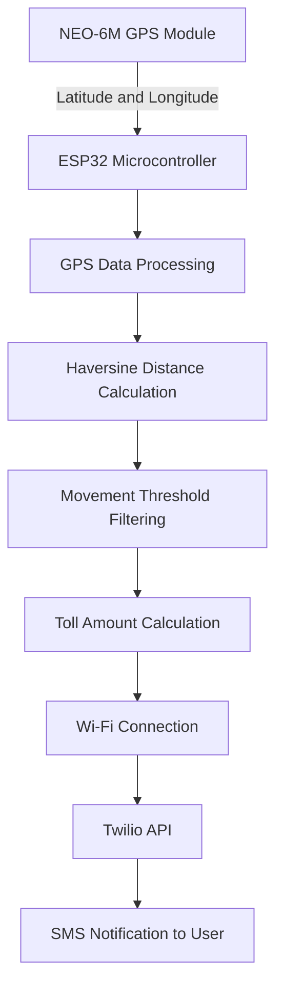

# GPS-Based Toll Collection System

## Overview

The **GPS-Based Toll Collection System** is an IoT-based project developed to automate toll calculation based on the distance travelled by a vehicle. The system uses an ESP32 microcontroller and a NEO-6M GPS module to continuously track geographical location and calculate the distance travelled.

The Haversine formula is used to calculate the distance between successive GPS coordinates. Based on the accumulated distance and a predefined toll rate, the system calculates the toll amount and sends SMS notifications to the registered mobile number using the Twilio API over a Wi-Fi connection.

The project aims to reduce dependency on traditional toll booths, minimize manual intervention, and provide users with timely toll updates.

## Objectives

- Develop a GPS-based system for tracking vehicle movement.
- Calculate the distance travelled using real-time GPS coordinates.
- Implement the Haversine formula for distance calculation.
- Calculate toll charges based on distance travelled.
- Filter minor GPS fluctuations using a movement threshold.
- Send toll details through SMS notifications.
- Develop a portable and cost-effective IoT-based solution.

## System Architecture

The following diagram represents the main workflow of the implemented system.

## Hardware Components

| Component | Purpose |
|---|---|
| ESP32 Microcontroller | Main processing and control unit |
| NEO-6M GPS Module | Obtains real-time location coordinates |
| SIM800L GSM Module | Listed as a communication component in the project report |
| LED Indicators | Provide module status indications |
| USB Power Supply / Power Bank | Supplies power to the system |

**Communication Note:** The documented implementation sends SMS through the ESP32's Wi-Fi connection and Twilio API. The SIM800L is listed in the report, but the supplied implementation code uses Wi-Fi/Twilio rather than direct SIM800L messaging.

## Software and Technologies

- **Programming Language:** Embedded C/C++ (Arduino framework)
- **Microcontroller Platform:** ESP32
- **Development Environment:** Arduino IDE
- **GPS Library:** TinyGPS++
- **Communication:** Wi-Fi
- **HTTP Communication:** HTTPClient
- **SMS Service:** Twilio API
- **Data Format:** ArduinoJson
- **Distance Calculation:** Haversine Formula

## Working Principle

1. **System Initialization:** The ESP32 initializes the GPS module and establishes a Wi-Fi connection.

2. **GPS Data Acquisition:** The NEO-6M GPS module continuously provides latitude and longitude coordinates.

3. **GPS Data Processing:** The TinyGPS++ library parses the GPS data and extracts valid geographical coordinates.

4. **Distance Calculation:** The Haversine formula calculates the distance between successive GPS coordinates.

5. **Movement Filtering:** A minimum movement threshold of 0.5 meters is applied to ignore insignificant GPS fluctuations.

6. **Toll Calculation:** The system calculates the toll amount using the accumulated distance and a predefined rate of ₹50 per kilometer.

7. **SMS Notification:** When the vehicle covers another 10 kilometers beyond the previous notification point, the ESP32 sends an SMS containing the distance travelled and calculated toll amount through the Twilio API.

## Toll Calculation

The toll amount is calculated using the following formula:

**Toll Amount = Total Distance Travelled (km) × Toll Rate**

### Example

| Parameter | Value |
|---|---:|
| Distance Travelled | 10 km |
| Toll Rate | ₹50 per km |
| Calculated Toll Amount | ₹500 |

The system sends toll updates at predefined distance intervals.

## Key Features

- Real-time GPS location tracking.
- Distance calculation using the Haversine formula.
- GPS movement threshold filtering.
- Automatic distance-based toll calculation.
- SMS notifications through the Twilio API.
- ESP32-based processing and Wi-Fi connectivity.
- Portable and low-cost system design.
- Serial Monitor output for debugging and monitoring.

## Testing and Results

The project was tested by moving the GPS device to simulate vehicle movement.

The testing demonstrated:

- Successful acquisition of GPS coordinates.
- Distance calculation between successive GPS positions.
- Filtering of minor GPS fluctuations.
- Calculation of toll amounts based on accumulated distance.
- SMS notifications when the specified distance interval was reached.
- Monitoring of GPS coordinates, distance, and toll values through the Serial Monitor.

## Applications

- Smart transportation systems.
- GPS-based vehicle monitoring.
- Distance-based toll calculation prototypes.
- Fleet monitoring applications.
- IoT-based transportation solutions.

## Future Enhancements

- Mobile application integration.
- Cloud-based storage of travel and toll records.
- Improved GPS accuracy and reliability.
- Offline communication support.
- Dynamic toll rate calculation.
- Integration with secure online payment systems.

## Conclusion

The GPS-Based Toll Collection System demonstrates how IoT technology can be used to develop a distance-based toll monitoring solution. By integrating ESP32, GPS technology, distance calculation algorithms, Wi-Fi connectivity, and the Twilio API, the system tracks vehicle movement, calculates toll charges, and sends SMS notifications to users.

The project provides a foundation for developing more advanced and intelligent transportation systems.

## Project Information

- **Project Title:** GPS-Based Toll Collection System
- **Domain:** Embedded Systems and Internet of Things (IoT)
- **Degree:** Bachelor of Engineering – Electronics and Communication Engineering
- **Institution:** Malnad College of Engineering, Hassan
- **Academic Year:** 2024–2025

## Acknowledgement

We sincerely thank our project guide, faculty members, and the Department of Electronics and Communication Engineering, Malnad College of Engineering, Hassan, for their guidance and support throughout the project.
